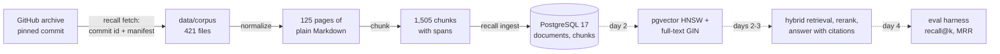

# Recall

Retrieval-augmented question answering over a documentation set, with a citation for every claim and an evaluation
harness that measures retrieval and answer faithfulness. PostgreSQL 17 does all the retrieval: pgvector (HNSW) for
meaning, full-text search for exact words, fused by reciprocal rank fusion, then reranked by a small cross-encoder.
Everything runs on a laptop CPU with no API key.

[DESIGN.md](DESIGN.md) is the specification. [WALKTHROUGH.md](WALKTHROUGH.md) answers the questions an interviewer is
likely to ask.

## Status

| Day | What | State |
|---|---|---|
| 1 | Design; the corpus (fetched, checked, normalized); chunking; the schema and ingest; the local database; CI | done |
| 2 | Local embeddings in pgvector (HNSW), full-text retrieval, hybrid by reciprocal rank fusion | planned |
| 3 | Answers with citations (recorded LLM provider, extractive fallback), a cross-encoder reranker, the API | planned |
| 4 | The eval harness: labelled questions with gold passages, recall@k, MRR, faithfulness; a CI gate | planned |
| 5 | The ablation table, results, v1.0.0 | planned |

## Why it is built this way

- **One database.** Documents, chunks, vectors and full-text indexes live in PostgreSQL, so ingest is one transaction
  and hybrid retrieval (day 2) is one SQL query rather than a join across a vector store and a search engine.
- **Citations point at exact spans.** A chunk is a verbatim slice of its normalized page (`content[start:end]`), so a
  citation can show exactly what was retrieved and link to the section it came from.
- **The corpus is reproducible.** The archive's bytes aren't pinned (GitHub regenerates archives); the commit id the
  archive declares and the SHA-256 of each of the 421 files used are, so anyone gets the same corpus or an error.
- **Measured, not asserted.** Day 4's harness turns "hybrid retrieval is better" into recall@k and MRR per retriever,
  and CI fails when they drop.

## Architecture



## Layout

```
src/recall/
  markdown.py             lines, fenced code blocks and ATX headings (the parts both stages need)
  chunking.py             sections, blocks, greedy packing by tokens; invariants C1-C7
  corpus/source.py        the pinned source and which pages are kept
  corpus/fetch.py         download, the commit and manifest checks, all-or-nothing extraction
  corpus/manifest.json    the 421 files used, with sizes and SHA-256
  corpus/normalize.py     FastAPI's Markdown extensions to plain Markdown
  corpus/load.py          an extracted corpus to Documents
  ingest.py               documents and chunks into PostgreSQL, idempotent, one transaction
  db.py                   connections and migrations
  migrations/             numbered SQL files
  cli.py                  the recall command
scripts/pg.sh             the project-local PostgreSQL 17 cluster (port 5544)
tests/                    unit, property (Hypothesis), database and real-corpus tests
```

## How to run

Needs Python 3.11 and PostgreSQL 17 with pgvector (`brew install postgresql@17 pgvector` on macOS).

```bash
make venv                      # .venv with recall and the dev tools
scripts/pg.sh start            # the local cluster on port 5544: databases recall and recall_test
.venv/bin/recall fetch         # FastAPI 0.157.0's docs into data/corpus (about 18 MB downloaded, 421 files kept)
.venv/bin/recall verify        # check data/corpus against the manifest
.venv/bin/recall stats         # chunk the corpus and print its sizes
.venv/bin/recall ingest        # load it into the recall database (runs the migrations first)
make check                     # ruff, mypy --strict, and the tests (they use recall_test)
scripts/pg.sh stop
```

`recall ingest --max-tokens N` and `recall stats --max-tokens N` chunk with another size; ingest then re-chunks every
document. Settings: `RECALL_DATABASE_URL` (default `postgresql://localhost:5544/recall`), `RECALL_TEST_DATABASE_URL`
(default `.../recall_test`), `RECALL_DATA_DIR` (default `data`).

## Results (day 1)

The corpus, chunked with the default `max_tokens` 256 (`.venv/bin/recall stats`, at `40a7144`; the numbers are
deterministic, and CI's corpus job prints the same table from a fresh download):

| | |
|---|---|
| Pages kept | 125 of FastAPI's 156 English pages |
| Files in the manifest | 421 (125 pages, 295 included code files, the license) |
| Normalized text | 972,663 characters |
| Chunks | 1,505 |
| Tokens (Recall's measure) | 217,429 |
| Tokens a chunk | min 3, p50 142, p95 253, max 256; 27 chunks at the maximum |

The same commit's archive by tag and by commit id differ in bytes (18,018,516 and 18,023,996, since the top
directory is named after what was asked for) and give the same manifest, which is why the files are pinned rather than
the archive.

`recall ingest` on that corpus: 125 added and 1,505 chunks written, then 125 unchanged and nothing written; every
stored chunk equals `substr(document.content, start + 1, end - start)` (checked in SQL, and by `test_ingest.py`).

## Tests

`make check` runs ruff, `mypy --strict` and pytest: 124 tests at `4dfd206`, all passing here. In CI's test job the 7
real-corpus tests skip (116 passed, 7 skipped at `40a7144`, line and branch coverage 98%), and its corpus job runs them.

- **Chunking:** one example per rule, and Hypothesis properties for C1 to C7 over random documents built from known
  parts (headings, paragraphs, lists, fences with `#` lines, blank lines and non-closing fence runs inside), so the
  test knows where each heading and fence is; and the rules that need no structure over arbitrary text.
- **Normalization:** one test per rule, the error cases, and a golden page that uses every extension.
- **Fetch:** archives built in the test (another commit, a changed file, a missing file, a symlink, duplicate members,
  a member outside the top directory, unsafe manifest paths, an archive over the size limit); no network.
- **Database:** migrations (once, in order, concurrent migrators); ingest (idempotence, changed, retitled and removed
  documents, new settings, a failure part way rolls back, concurrent ingests queue), each test in its own schema.
- **The real corpus** (`tests/test_real_corpus.py`): every page loads, normalizes idempotently, has no build syntax
  left, and chunks within the invariants at two sizes; the manifest holds exactly what the pages use; a pin of the
  chunk count for this chunker version. Skipped without a fetched corpus, required in CI's corpus job.

CI (GitHub Actions) has two jobs: lint, types and tests against a `pgvector/pgvector:pg17` service container; and the
corpus job, which downloads the pinned archive from GitHub, verifies it and runs the real-corpus tests.

## Design decisions

- **FastAPI's docs as the corpus.** MIT-licensed, one subject, many near-duplicate passages that differ in detail, and
  questions that mix plain words with exact identifiers: a corpus where hybrid retrieval should matter.
- **Normalize before chunking, and keep offsets into the normalized text.** Code includes are expanded, so a question
  about code finds the code; spans then refer to what was embedded, not to source the reader never sees.
- **Chunks of whole blocks, no overlap.** Cuts fall between paragraphs and code blocks; each chunk carries its page
  title and heading path for context instead of repeating its neighbour's text.
- **A token measure of word runs and single punctuation.** Closer to word pieces than words, and exactly additive, so
  the size bound is exact. Day 2 checks it against the embedding model's own tokenizer.
- **One transaction for the whole ingest.** 1,505 chunks take well under a second, and readers never see a mix of
  two corpora; the cost is a long transaction for a much bigger corpus.
- **The builtin C.UTF-8 collation** locally and in CI, so text sorts by code point in both places.

## Limitations

- The Markdown scanner is not CommonMark: fences may be indented any amount (FastAPI indents fences in lists),
  setext headings are not headings, and HTML-like text outside code spans (`List<int>`) is stripped as a tag.
- Normalization is written for FastAPI's documentation build; another corpus needs its own rules.
- The token measure approximates the embedding model's tokens; a code-heavy chunk can have more model tokens.
- The local cluster uses trust authentication on localhost; it is for development only.

## License

MIT (see [LICENSE](LICENSE)). The corpus is FastAPI's documentation (MIT, © Sebastián Ramírez); `recall fetch`
downloads it and keeps FastAPI's LICENSE beside it in `data/corpus/`; it is not committed here.
