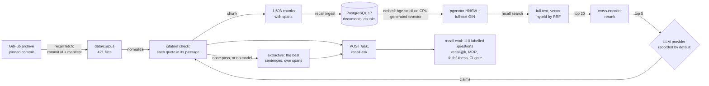

# Recall

Retrieval-augmented question answering over a documentation set, with a citation for every claim and an evaluation
harness that measures retrieval and answer faithfulness. PostgreSQL 17 does all the retrieval: pgvector (HNSW) for
meaning, full-text search for exact words, fused by reciprocal rank fusion, then reranked by a small cross-encoder.
Everything runs on a laptop CPU with no API key.

[DESIGN.md](DESIGN.md) is the specification. [WALKTHROUGH.md](WALKTHROUGH.md) answers the questions an interviewer is
likely to ask.

## Status

| Day | What | State |
|---|---|---|
| 1 | Design; the corpus (fetched, checked, normalized); chunking; the schema and ingest; the local database; CI | done |
| 2 | Local embeddings in pgvector (HNSW), full-text retrieval, hybrid by reciprocal rank fusion, `recall search` | done |
| 3 | A cross-encoder reranker, answers with checked citations (recorded LLM provider, extractive fallback), the API, `recall ask` | done |
| 4 | The eval harness: 110 labelled questions, recall@k and MRR per system, faithfulness checks, a CI gate | done |
| 5 | The ablation table, results, v1.0.0 | planned |

## Why it is built this way

- **One database.** Documents, chunks, vectors and full-text indexes live in PostgreSQL, so ingest is one transaction
  and hybrid retrieval (day 2) is one SQL query rather than a join across a vector store and a search engine.
- **Citations point at exact spans.** A chunk is a verbatim slice of its normalized page (`content[start:end]`), so a
  citation can show exactly what was retrieved and link to the section it came from.
- **The corpus is reproducible.** The archive's bytes aren't pinned (GitHub regenerates archives); the commit id the
  archive declares and the SHA-256 of each of the 421 files used are, so anyone gets the same corpus or an error.
- **Measured, not asserted.** Day 4's harness turns "hybrid retrieval is better" into recall@k and MRR per retriever,
  and CI fails when they drop. Its first run said hybrid is *not* better here (below).

## Architecture



## Layout

```
src/recall/
  markdown.py             lines, fenced code blocks and ATX headings (the parts both stages need)
  chunking.py             sections, blocks, greedy packing by tokens; invariants C1-C8
  corpus/source.py        the pinned source and which pages are kept
  corpus/fetch.py         download, the commit and manifest checks, all-or-nothing extraction
  corpus/manifest.json    the 421 files used, with sizes and SHA-256
  corpus/normalize.py     FastAPI's Markdown extensions to plain Markdown
  corpus/load.py          an extracted corpus to Documents
  ingest.py               documents, chunks and their vectors into PostgreSQL, idempotent, one transaction
  embedding.py            the Embedder interface, bge-small-en-v1.5 (pinned), a hash stub for tests
  retrieval.py            full-text, vector, and hybrid (reciprocal rank fusion) retrieval, each one SQL query
  rerank.py               the Reranker interface, the MiniLM cross-encoder (pinned), an overlap stub for tests
  llm.py                  the LLM provider interface: recorded (default), Claude (opt-in), the recorder
  citations.py            the answer's JSON schema and the citation check (each quote in its passage, exact spans)
  extractive.py           sentences outside code, and the extractive answer (the reranker's best sentences)
  answer.py               the prompt, answer() with its fallbacks, ask(): retrieve() then respond()
  evaluation.py           questions, gold chunks from quotes, five systems, recall@k, MRR, the gate, the sign test
  faithfulness.py         claims checked against the passages they cite; answers that cite gold
  api.py                  the FastAPI app: POST /ask, POST /search, GET /healthz
  db.py                   connections, migrations, pgvector's text form
  migrations/             numbered SQL files
  cli.py                  the recall command
scripts/pg.sh             the project-local PostgreSQL 17 cluster (port 5544)
scripts/token_fit.py      the chunks counted in the embedding model's own tokens
scripts/measure_retrieval.py   HNSW against exact search, and each step's latency
scripts/measure_answers.py     each answering step's latency, in-process or over HTTP
scripts/sweep_fusion.py   hybrid across RRF k and candidates, on two halves of the questions
eval/questions.jsonl      110 labelled questions (synthetic), each with gold quotes
eval/baseline.json        the committed evaluation report that CI's gate compares with
recordings/               recorded LLM responses (none yet: no key here; see its README)
tests/                    unit, property (Hypothesis), database and real-corpus tests
```

## How to run

Needs Python 3.11 and PostgreSQL 17 with pgvector (`brew install postgresql@17 pgvector` on macOS).

```bash
make venv                      # .venv with recall and the dev tools
scripts/pg.sh start            # the local cluster on port 5544: databases recall and recall_test
.venv/bin/recall fetch         # FastAPI 0.157.0's docs into data/corpus (about 18 MB downloaded, 421 files kept)
.venv/bin/recall verify        # check data/corpus against the manifest
.venv/bin/recall stats         # chunk the corpus and print its sizes
.venv/bin/recall show tutorial/query-params.md   # one page's chunks, with spans and heading paths
.venv/bin/pip install -e '.[embed]'   # PyTorch and sentence-transformers, for the embedding model
.venv/bin/recall ingest        # load and embed it into the recall database (runs the migrations; ~40 s on a laptop CPU)
.venv/bin/recall search "how do I give a query parameter a default value?"   # hybrid; --mode full-text | vector
.venv/bin/recall ask "How do I upload a file?"   # retrieve, rerank, answer with citations (--json: what /ask returns)
.venv/bin/recall serve                           # the API on 127.0.0.1:8109 (models load once, ~5 s)
curl -s localhost:8109/ask -H 'content-type: application/json' -d '{"question": "How do I upload a file?"}'
.venv/bin/recall eval --answers --check eval/baseline.json   # the evaluation and CI's gate (~2 minutes)
make check                     # ruff, mypy --strict, and the tests (they use recall_test)
scripts/pg.sh stop
```

`recall ingest --max-tokens N` and `recall stats --max-tokens N` chunk with another size; ingest then re-chunks every
document. `--embedder hash` (or `RECALL_EMBEDDER=hash`) uses the dependency-free stub instead of the model, for trying
the pipeline without PyTorch; ingest with another embedder embeds every chunk again, and search refuses vectors made by
another embedder than its own. The first use of the model downloads it (133 MB) from Hugging Face, at a pinned
revision. Settings: `RECALL_DATABASE_URL` (default `postgresql://localhost:5544/recall`), `RECALL_TEST_DATABASE_URL`
(default `.../recall_test`), `RECALL_DATA_DIR` (default `data`).

**Answers.** `RECALL_LLM` picks who writes them: `recorded` (the default) replays a recording of the exact prompt from
`recordings/` (`RECALL_RECORDINGS`) and otherwise gives the extractive answer; `none` always gives the extractive
answer; `anthropic` calls Claude (`claude-opus-5-5`, or `RECALL_LLM_MODEL`) through the official SDK, which needs
`pip install -e '.[llm]'` and a key in the environment (`ANTHROPIC_API_KEY`, never written to the repository), and
`RECALL_RECORD=1` saves each live answer as a recording. Tests and CI never call it. `RECALL_RERANKER=overlap` (or
`--reranker overlap`) uses the stub instead of the cross-encoder. The first use of the reranker downloads it (91 MB).

## Results (day 1)

The corpus, chunked with the default `max_tokens` 256 (`.venv/bin/recall stats` at `0e87c41`, chunker version 2;
the numbers are deterministic, and CI's corpus job prints the same table from a fresh download):

| | |
|---|---|
| Pages kept | 125 of FastAPI's 156 English pages |
| Files in the manifest | 421 (125 pages, 295 included code files, the license) |
| Normalized text | 972,537 characters |
| Chunks | 1,503 |
| Tokens (Recall's measure) | 217,390 |
| Tokens a chunk | min 7, p50 147, p95 250, max 256; 20 chunks at the maximum |

Before the last cut of each section was evened out (chunker version 1), the same 1,503 chunks had min 3, p50 142,
p95 253, 27 at the maximum, and three chunks that were only a closing fence; chunks under 20 tokens went from 41 to
30.

The same commit's archive by tag and by commit id differ in bytes (18,018,516 and 18,023,996, since the top
directory is named after what was asked for) and give the same manifest, which is why the files are pinned rather than
the archive.

`recall ingest` at `ba23111`: 125 added and 1,505 chunks written, then 125 unchanged and nothing written. After the
front-matter fix: 2 updated (the two pages that have front matter), 123 unchanged, 49 chunks written, 1,503 stored;
then 125 unchanged. After chunker version 2 (and the one-pass normalizer, which dropped `index.md`'s CSS): 125
updated, 1,503 chunks written, then 125 unchanged. Every stored chunk equals `substr(document.content, start + 1, end - start)` (checked in SQL, and by
`test_ingest.py`).

## Results (day 2)

Apple M3, macOS 26.6.2, Python 3.11.12, PostgreSQL 17.11 + pgvector 0.8.7. The token fit and ingest runs were on
battery (Low Power Mode off); the latency below on AC power.

**Token fit** (`.venv/bin/python scripts/token_fit.py`; the same in CI's model job): the 1,503 passages (heading path +
chunk) are min 13, p50 187, p95 339, p99 422 and max 723 model tokens, 1.29 model tokens per Recall token at the median;
1 is over bge-small's 512 (a base64 PNG). all-MiniLM-L6-v2's 256 would truncate 369 (24.6%).

**Ingest** (`/usr/bin/time -p .venv/bin/recall ingest`, the day-1 database migrated in place): 125 documents unchanged,
1,503 chunks embedded, 38.9 s wall.

**HNSW against exact search** (`.venv/bin/python scripts/measure_retrieval.py` at `47dc914`; 300 synthetic questions,
the corpus's section titles, which are easy: each is in its own section's embedded text):

| hnsw.ef_search | share of the exact top 10 returned | questions with all 10 |
|---|---|---|
| 10 | 0.9447 | 226 of 300 |
| 20 | 0.9687 | 250 of 300 |
| 40 (pgvector's default; Recall's floor) | 0.9893 | 277 of 300 |
| 60 | 0.9940 | 286 of 300 |
| 100 | 0.9987 | 296 of 300 |

The HNSW side forces the index (`enable_seqscan = off`) and the script checks every plan: on 1,503 rows the planner
picks a sequential scan instead from about ef_search 80 to 100. A first run checked the plan only at 40 and reported
1.0000 at 100, which was that exact scan (`83fbda8`, corrected in `9c4f90b`).

**Latency** (the same script and questions, after 30 untimed, at `54e37aa`, on AC power with nothing else running; ms):

| step | p50 | p95 | p99 | max |
|---|---|---|---|---|
| embed the question (bge-small, CPU) | 5.60 | 5.89 | 6.01 | 7.07 |
| full-text query | 0.78 | 2.33 | 2.95 | 3.67 |
| vector query (top 10, HNSW index) | 0.76 | 0.86 | 0.91 | 0.94 |
| hybrid query (50 candidates a list) | 1.53 | 2.94 | 4.00 | 4.43 |
| hybrid end to end (embed + query) | 8.06 | 9.57 | 10.59 | 10.88 |

An earlier run on battery at `47dc914` was within a few tenths of a millisecond of these (hybrid end to end p50 7.41).
`recall search` as a command takes about 5 s, nearly all of it loading the model.

**Smoke questions** (`tests/test_real_retrieval.py`, six hand-written questions, not an evaluation; rank of the page in
each mode's top 10, the same here and in CI):

| question | page | full-text | vector | hybrid |
|---|---|---|---|---|
| Allow a frontend on another origin to call my API | tutorial/cors.md | 1 | 1 | 2 |
| response_model_exclude_unset | tutorial/response-model.md | 1 | 1 | 1 |
| How do I upload a file? | tutorial/request-files.md | 1 | 1 | 1 |
| How do I declare a query parameter with a default value? | tutorial/query-params.md | 7 | 3 | 4 |
| How can I run a function after returning the response? | tutorial/background-tasks.md | - | 10 | - |
| How do I return a custom status code for an error? | tutorial/handling-errors.md | - | 4 | - |

## Results (day 3)

Apple M3, macOS 26.6.2, Python 3.11.12, on battery (Low Power Mode off); the real corpus and models.

**The reranker's input** (`.venv/bin/python scripts/token_fit.py --reranker --question "..."`; the same in CI's model job
for the first two): with the question attached, the 1,503 passages are pairs of p50 192 / max 728 tokens for "upload a
file" (1 over the cross-encoder's 512), p50 200 for the 11-word query-parameter smoke question (2 over), and p50 213 /
max 749 for a 24-word question (3 over, 0.2%). A pair over 512 loses the passage's end.

**Smoke questions, reranked** (`tests/test_real_retrieval.py`; six hand-written questions, not an evaluation; rank of the
page; the same here and in CI on Linux). The last column is hybrid's top 20 reranked by the cross-encoder, which is
what `ask` answers from (its top 5):

| question | page | full-text | vector | hybrid | hybrid + rerank |
|---|---|---|---|---|---|
| Allow a frontend on another origin to call my API | tutorial/cors.md | 1 | 1 | 2 | 1 |
| response_model_exclude_unset | tutorial/response-model.md | 1 | 1 | 1 | 1 |
| How do I upload a file? | tutorial/request-files.md | 1 | 1 | 1 | 1 |
| How do I declare a query parameter with a default value? | tutorial/query-params.md | 7 | 3 | 4 | 1 |
| How can I run a function after returning the response? | tutorial/background-tasks.md | - | 10 | - | - |
| How do I return a custom status code for an error? | tutorial/handling-errors.md | - | 4 | - | 5 |

Reranking can only reorder what hybrid retrieved: background-tasks.md isn't in hybrid's top 20 (full-text misses it, so
fusion ranks it low), and stays missed. Day 4 measures this on a labelled set.

**Extractive answers.** With no recording (none exists: there is no key here), every answer is extractive: the
reranker's three best sentences from the top 5 passages. For "How do I upload a file?" (`recall ask`):

> You can also use `File()` with `UploadFile`, for example, to set additional metadata: [4] It's possible to upload
> several files at the same time. [2] You can get metadata from the uploaded file. [5]

Every citation is a span of its page (checked for all six smoke questions in CI), but the sentences are the
passages' own, chosen one by one: they answer in pieces, not in prose, and for the background-tasks question they
cite the wrong pages, since retrieval found none of the right ones.

**Sentences inside split code blocks.** Reading each passage in its page changed the sentences of 129 of the 1,503
chunks (5,836 sentences of four words or more read alone, 5,496 read in their pages).

## Results (day 4)

Apple M3, macOS 26.6.2, Python 3.11.12, on battery (Low Power Mode off); the real corpus (1,503 chunks) and models.

**The question set** (`eval/questions.jsonl`): 110 **synthetic** questions over 66 pages (69 counting the second
gold pages), written by a Claude agent
from the pages alone (no access to the retrievers or their results), each with gold quotes from its page; 12 have a
second page that also answers. 55 are *identifier* questions, naming a term from their answer (often in its own
words, which favours full-text search), and 55 are *paraphrases* that avoid every distinctive term of their answer (on
purpose hard for full-text search). It is one writer's questions about one documentation set, not users' questions.

**Retrieval** (`.venv/bin/recall eval --answers --json eval/baseline.json` at `4ea760b`, 110.6 s; a second run gave the
same numbers; recall@k is the share of questions with a gold chunk in the top k, MRR is over the top 20):

| system | recall@1 | recall@3 | recall@5 | recall@10 | recall@20 | MRR@20 |
|---|---:|---:|---:|---:|---:|---:|
| full-text | 0.100 | 0.218 | 0.273 | 0.336 | 0.409 | 0.175 |
| vector | 0.355 | **0.600** | **0.627** | **0.727** | **0.791** | **0.491** |
| hybrid (RRF) | 0.264 | 0.382 | 0.473 | 0.591 | 0.718 | 0.357 |
| vector + rerank | **0.391** | 0.545 | 0.573 | 0.682 | 0.791 | 0.487 |
| hybrid + rerank (ask's default) | 0.382 | 0.518 | 0.555 | 0.645 | 0.718 | 0.469 |

By kind, recall@10 (MRR@20): identifier questions: full-text 0.618 (0.335), vector 1.000 (0.732), hybrid 0.909
(0.588), vector + rerank 0.964 (0.775), hybrid + rerank 0.982 (0.778); paraphrases: full-text 0.055 (0.016), vector
0.455 (0.250), hybrid 0.273 (0.127), vector + rerank 0.400 (0.200), hybrid + rerank 0.309 (0.160).

**What it says.** The default pipeline isn't the best one on this set. Vector search alone beats hybrid at every k, and
hybrid + rerank (what `ask` does) from k = 3 up: at recall@10 it finds 15 questions hybrid misses and hybrid finds none
it misses (exact sign test
p = 0.0001; `recall eval` prints these paired counts for every system against the default). Full-text search is weak
even on identifier questions (0.618 at 10), because ts_rank_cd has no inverse document frequency and the query ORs
every word, so common words rank chunks that share them; fusing its list in pulls those chunks up. The reranker helps
hybrid at the top (recall@1: 18 questions gained, 5 lost, p = 0.011) but doesn't change vector significantly (11 vs 7
at 1, p = 0.48); on paraphrases it lowers vector's MRR (0.250 to 0.200): the MS MARCO cross-encoder leans on shared
words too. Paraphrases are hard for everything: the best recall@10 is 0.455.

**Fusion settings** (`.venv/bin/python scripts/sweep_fusion.py`, at `713a52a`): hybrid at candidates 20/50/100 and RRF
k 1/10/30/60/120, scored on the odd-numbered and even-numbered questions separately, so a choice made on one half can be
checked on the other. No setting beats vector alone on either half. A smaller k helps hybrid on both halves (MRR@20 at
candidates 50: 0.468 / 0.384 at k = 1 against 0.420 / 0.295 at the default 60; vector alone 0.544 / 0.438), and more
candidates hurt at k = 60. So the defaults stay for now: the problem is the full-text list, not the fusion, and day 5
measures IDF weighting for it before choosing.

**Answers** (the same run, `--answers`: each question answered as `recall ask` does, hybrid + rerank, 5 passages):
all 110 answers are extractive (no recordings, no key), 330 claims, every one supported by the lexical check, which is
true by construction for extractive claims (they are the passages' sentences): on this machine that number tests the
harness, not a model. The informative ones: 55.5% of answers were written from passages that include a gold chunk (the
same as hybrid + rerank's recall@5), and 50.0% cite one.

**The gate.** CI's model job ingests the corpus, runs `recall eval --answers --check eval/baseline.json`, writes the
tables to the run's summary and keeps the report as an artifact. It fails on a drop of more than one question's worth
in any system's recall@k or 0.01 in MRR, or on different settings (a changed question file, corpus, chunker, model or
fusion setting needs a new baseline committed with it). The slack is needed: on Linux (CI run 40105681993, at
`f507a79`, 412.5 s) every number matched the Mac's except hybrid's recall@10, 0.582 (one question fewer), and
vector + rerank's recall@1, 0.400 (one more), with its MRR 0.492; the gate passed.

## Tests

`make check` runs ruff, `mypy --strict` and pytest: 552 passed and 16 skipped at `713a52a` (30 s; the 16 are the
real-model tests, run with `RECALL_REQUIRE_MODEL=1 pytest -m model`). In CI's test job
the real-corpus tests and the cluster script's tests skip (220 passed, 9 skipped at `0777cfe`, line and branch coverage
99%); the corpus and pg-script jobs run them.

- **Chunking:** one example per rule, and Hypothesis properties for C1 to C8 over random documents built from known
  parts (headings, paragraphs, lists, fences with `#` lines, blank lines and non-closing fence runs inside), so the
  test knows where each heading and fence is; and the rules that need no structure over arbitrary text.
- **Normalization:** one test per rule, the error cases, and a golden page that uses every extension.
- **Fetch:** archives built in the test (another commit, a changed file, a missing file, a symlink, duplicate members,
  a member outside the top directory, unsafe manifest paths, an archive over the size limit); no network.
- **Database:** migrations (once, in order, concurrent migrators); ingest (idempotence, changed, retitled and removed
  documents, new settings, a failure part way rolls back, concurrent ingests queue), each test in its own schema.
- **The real corpus** (`tests/test_real_corpus.py`): every page loads, normalizes idempotently, has no build syntax
  left, and chunks within the invariants at two sizes; the manifest holds exactly what the pages use; a pin of the
  chunk count for this chunker version. Skipped without a fetched corpus, required in CI's corpus job.

- **Normalization properties:** generated pages keep their own code unchanged, get one block per include, keep every
  visible word, have no build syntax, tags or comments left outside code, and normalize idempotently.
- **The local cluster** (`tests/test_pg_script.py`): `scripts/pg.sh` start, status, url, psql, stop, a restart that
  keeps the data, and reset (which leaves a directory that isn't a cluster alone), on a throwaway cluster.
- **Embeddings and ingest's embedding step** (day 2, `tests/test_embedding.py`, `tests/test_ingest_embedding.py`): the
  hash embedder's properties; stored vectors equal to a fresh embedding of each passage; only new chunks embedded; a new
  model re-embedding everything with chunk ids kept; a model failing part way, of the wrong dimension, returning too
  few vectors or a NaN, each rolling back; a day-1 database migrated in place; the search vector's lexemes and weights.
- **Retrieval** (`tests/test_retrieval.py`): each retriever on corpora whose rankings the hash embedder makes
  predictable; hybrid against a Python fusion of the two lists (Hypothesis over questions, k, candidates, RRF k);
  identifiers matched as written; questions holding tsquery syntax or nothing searchable; k past pgvector's default
  ef_search; `EXPLAIN` showing both indexes usable. Six mechanisms (the ef_search raise, OR, the rank in one RRF term,
  the tie order, the weights, the per-word phrases) were each removed once, and a test failed every time.
- **The real model** (`-m model`): the pinned name, 384-wide unit vectors, the query prefix, the input length, three
  obvious rankings; `tests/test_real_retrieval.py` ingests the real corpus with it and searches six hand-written
  questions in every mode (a smoke test). They skip without the `embed` extra, except in CI's model job.

- **Answers** (day 3): the provider interface (`tests/test_llm.py`: request keys, recordings replayed and refused when
  edited or unreadable, the recorder, the live provider's request and failures with a fake client, and the real
  `anthropic` SDK against a local stand-in for the API, so the request on the wire is checked without a key); the
  citation check (`tests/test_citations.py`: one test per rule and reason, and Hypothesis: no JSON value makes it raise
  anything but MalformedAnswer, and any quote taken from a passage checks out with the span it came from); sentences
  and the extractive answer (`tests/test_extractive.py`, with a chunk inside a split code block and Hypothesis over
  generated Markdown); the reranker (`tests/test_rerank.py`, the real cross-encoder's rankings and pinned length under
  `-m model`); `answer` and `ask` with every fallback (`tests/test_answer.py`); the API through a test client
  (`tests/test_api.py`: answers, a replayed recording, search, health, every 422 and 503); `recall ask` and `recall
  serve` (`tests/test_cli_ask.py`); and on the real corpus, the reranked smoke questions and that every answer cites
  spans of its own pages.

- **Evaluation** (day 4, `tests/test_evaluation.py`, `tests/test_cli_eval.py`, `tests/test_faithfulness.py`): the
  question file's rules; gold chunks from quotes (a quote across a chunk boundary, on two pages, in a heading, absent,
  repeated); recall@k and MRR by hand, and Hypothesis (recall grows with k; MRR lies between recall@1 and recall@20);
  every system on a small corpus (reranked lists are permutations); the sign test by hand and symmetric; the gate (the
  same, one question's slack, a two-question drop, MRR, other settings); `recall eval`'s tables, report and exit codes;
  faithfulness on hand-written claims (a wrong number, an invented parameter, unrelated words, citing the wrong passage,
  and a negation that passes: the check's known limit).

CI (GitHub Actions) has four jobs: lint, types and tests against a `pgvector/pgvector:pg17` service container; the
corpus job, which downloads the pinned archive from GitHub, verifies it and runs the real-corpus tests; the pg-script
job, which installs PostgreSQL 17 and pgvector on Ubuntu and runs the cluster script's test; and the model job, which
installs CPU-only PyTorch, caches the model, and runs the `model` tests on the real corpus, writing the token fit and
the smoke questions' ranks to the run's summary; then it ingests the corpus and runs the evaluation gate (day 4).

## Review of day 1

Three review agents, one after the other, each at a fixed commit in its own worktree, worded as correctness reviews,
saving every bug they reproduced as a failing test (kept in `tests/review/`, `tests/review2/` and `tests/review3/`); each was reproduced
here before it was fixed.

- **Review 1** (at `40a7144`, 15 minutes): the chunker held up under 20,000 fuzzed inputs; 23 failing tests elsewhere.
  Normalization handled fences, comments and code spans in separate passes that disagreed: a comment around a code
  block kept the code, `<!--` inside a code span swallowed the page up to the next `-->`, a raw include inside a
  comment was expanded, `index.md`'s `<style>` CSS was page text, and the manifest missed includes on CRLF pages. Now
  one pass in document order, and `includes()` is the set of files `normalize()` reads. Also: a failed rename lost
  the corpus; `verify` followed a symlinked directory; a BOM hid a page's title; `# #` had the title `#`; concurrent
  migrators and ingests failed under a REPEATABLE READ default (READ COMMITTED is now set before each advisory lock);
  bad downloads and a missing database printed tracebacks. 22 of its 37 mutations survived. Two were dead code (now
  removed) and one is `load`'s "only files in the manifest" check, which `verify` makes unreachable; for the rest I
  added tests and ran each mutant again (with the fixes' own two mechanisms, 23 mutants): 21 caught at first, and the
  two that survived (deleting a page exclusion) showed my exclusion test iterated over the list it was testing. It
  has its own list now, and both are caught.
- **Review 2** (at `0e87c41`, 12 minutes, on everything since review 1, its fixes included): 20 failing tests, 11 bugs,
  most in those fixes. Removing markup could invent structure (`<b></b>```` became a fence opener that turned the
  rest of the page into code; `<b>#</b> Title` a heading), now escaped with a backslash; normalization wasn't
  idempotent for markup in admonition labels or before markers; `<style-guide>` was read as `<style>`; many unclosed
  `<style` openers took quadratic time; `### ## #` lost its title; the database error printed the URL's password;
  `pg.sh` failed with a relative data directory. It brute-forced the chunk rebalancing over 200,000 random cases and
  found it correct. Its surviving mutants got tests, each run again as a mutant.
- **Review 3** (at `0777cfe`, 12 minutes, only review 2's fixes): 10 failing tests, 7 bugs, again in the fixes. Output
  starting with `---` was read as front matter by a second pass (the guard looked at the page, not the output); an
  include line in a file included inside a fence was expanded by a second pass (such a file is now refused); my
  linear-time `<style>` fix stopped dropping an element whose attribute holds `<`; a code span couldn't continue from
  the page into an included file; and the database message could still show part of a password (an unescaped `@`,
  an unparseable URL's traceback) or run to two lines.

One judgement call went against the review: it expected a raw include outside a fence to become a fenced block, as
DESIGN.md said; the documentation build inserts it as Markdown, so Recall now does too and DESIGN.md says so.

## Review of day 2

One agent reviewed day 2 at `2fba151` (18 minutes, correctness framing, its own worktree), and reproduced 8 defects as
16 failing tests (`tests/review_d2/`), each fixed and each test checked to fail on the commit before its fix:

- **A vector list came back short after any ingest that rewrote chunks**: an HNSW scan picks its ef_search entries
  before dropping dead ones, and the index keeps deleted and updated rows until VACUUM: 31 of 60 after a model change.
  Fixed with pgvector's iterative scan (`fa35b0d`).
- k or candidates over 1,000 (pgvector's ef_search limit) failed, or silently returned 40 in a fresh session (`fa35b0d`).
- `search` checked the model in one snapshot and queried in another, so an ingest with another model between them
  mixed the two models' vectors (`9c93d03`).
- A 20,000-word question failed (ts_rank_cd allocates per query item): each distinct phrase once, the first 64
  (`1e29847`).
- Tracebacks instead of one-line errors: a day-1 schema, a model that can't load, a question that isn't UTF-8; and
  `RECALL_EMBEDDER=Hash` silently loaded the model (`08ecf27`).

From its judgement calls and surviving mutants: two hybrid tests that didn't test what their names said (`c4929b1`), a CI
step that couldn't fail (`47dc914`), an unknown mode run as hybrid, splitting at tabs and newlines untested.

A second agent reviewed the fixes alone at `3a4673c` (15 minutes) and found 3 defects in them (`tests/review_d2b/`):
the 64-word cap didn't bound the query, since one pasted list with no spaces is a single phrase of 40,000 nodes (now a
node budget, `f8f5f9a`); `search` inside a caller's transaction raised psycopg's error instead of its own (`fe2f75f`);
and the iterative scan gives up after `hnsw.max_scan_tuples` (20,000) visited entries, dead ones included, so ingest now
vacuums after a change (`b50239e`). It also found the first review's race test passing for the wrong reason (a new one
races between the check and the query, `fe2f75f`) and a test reading every schema's indexes, the likely cause of an
unexplained failure while the first agent ran (`0f494a6`).

A third agent reviewed the second round of fixes at `27dcf48` (9 minutes) and found 4 defects (`tests/review_d2c/`),
three of them regressions in those fixes: the post-ingest VACUUM failed a committed ingest on a non-autocommit
connection, or when it couldn't get its lock (now only on an idle autocommit connection, and a failure is a warning,
`c4c28dc`); the node budget didn't count the ORs between phrases (`68ab482`); and `recall search` held its connection
idle while the model loaded, which a server's idle timeout ends (`74d3c75`).

My own mistake, found during the second review: the first measurement script checked its plans only at ef_search 40,
so its "exact at 100" was the planner's sequential scan; the floor I had raised to 100 is back at 40 (`9c4f90b`).

## Review of day 4

First, the day-3 review's leftovers: `/ask` held its pooled connection through the reranker and the LLM call, so four
slow answers used up the pool and `/search` and `/healthz` failed meanwhile (now the API embeds before taking a
connection and returns it before any model runs; a one-connection pool in the test proves it, `f61cb71`); concurrent
writers of one recording shared a `.partial` name (`8c86895`); quotes matched inside words (`7eb0f72`).

Then one agent reviewed day 4 at `713a52a` (21 minutes, correctness framing, its own worktree) and reproduced 7
defects as 11 failing tests (`tests/review_d4/`), each checked to fail before its fix:

- Whitespace at either end of a quote turned the new word-boundary rule off: `" secure by default"` (a line copied
  with its newline) checked out inside "insecure by default" (`5dc64dd`).
- The gate passed any report against a baseline with no scores, and `recall eval` skipped it for a `--check` file
  holding JSON `null`; gold quotes repeated with overlap ("no, no" in "no, no, no") counted once; the sign test
  overflowed from 1,024 discordant questions (`bf7bbeb`).
- Faithfulness split "1,500" into "1" and "500" (a changed default passed) and treated "e.g." as a term (`4742ce8`).

It also ran 48 mutations; 19 left every test green. Each now fails a new test (touching chunks counted as gold;
`rrf_k` and `candidates` not reaching the query or the recorded settings; the threshold, the stem guard, dotted and
hyphenated terms, whole-word term matching; the API's retrieve clock; the paired table's reference system), except one
whose code was redundant and is gone (`d1ed563`). Its docs mismatches (69 gold pages, not 66; "faithfulness" in the CI
gate's comment though answers aren't gated; DESIGN's narrower description of exact terms) are fixed. Judgement calls
left as they are: the gate is overall and one-sided (a regression on one kind of question offset by the other passes);
answers aren't gated; acronym plurals and hyphenated English count as exact terms; stemming only strips a final `s`.

A second agent reviewed only those fixes (at `d1ed563`, 8 minutes) and found two defects, both in my fix of the
faithfulness terms (`tests/review_d4b/`, 6 cases, fixed in `e82579a`): a unit glued to a comma number ("1,024MB") split
off, so a claim copying its passage word for word was unsupported; and terms were still found inside bigger numbers in
the passage ("500" in "1,500", "10" in "10.5"), so a claim turning 1,500 into 500 passed. Of its 25 mutations, 13 left
the tests green; 12 fail a test now (`64fab9c`), and the 13th (the empty-baseline check) is equivalent to the
missing-system rule.

A third agent reviewed only that fix (at `64fab9c`, 10 minutes) and found it too broad: the guard against continuing a
number across "," or "." applied to every word edge, so `OAuth2` wasn't found in `fastapi.security.oauth2.OAuth2` (a
real corpus sentence); and a minus sign was ignored ("-5" was the term "5"). Both fixed in `2e7337b`
(`tests/review_d4c/`, 5 cases), with a table of found and not-found terms that kills its 12 listed mutants.

## Design decisions

- **FastAPI's docs as the corpus.** MIT-licensed, one subject, many near-duplicate passages that differ in detail, and
  questions that mix plain words with exact identifiers: a corpus where hybrid retrieval should matter.
- **Normalize before chunking, and keep offsets into the normalized text.** Code includes are expanded, so a question
  about code finds the code; spans then refer to what was embedded, not to source the reader never sees.
- **Chunks of whole blocks, no overlap.** Cuts fall between paragraphs and code blocks; each chunk carries its page
  title and heading path for context instead of repeating its neighbour's text.
- **A token measure of word runs and single punctuation.** Closer to word pieces than words, and exactly additive, so
  the size bound is exact. Against the embedding model's own tokenizer (day 2): 1.29 model tokens per Recall token at
  the median, and 1 of 1,503 passages over the model's 512.
- **One transaction for the whole ingest.** 1,503 chunks take well under a second, and readers never see a mix of
  two corpora; the cost is a long transaction for a much bigger corpus.
- **The builtin C.UTF-8 collation** locally and in CI, so text sorts by code point in both places.
- **bge-small-en-v1.5, pinned by revision** (day 2). 384 dimensions, 33.4M parameters, fast on a CPU; it reads 512
  tokens where all-MiniLM-L6-v2 reads 256, which would truncate a quarter of the passages (measured). The vectors are
  stored with the model's name, so two models' vectors never mix.
- **Heading path above the chunk text in what is embedded.** A chunk often doesn't name its subject; the path does.
- **Full-text as an OR of per-word phrases.** AND (plainto_tsquery) needs every word in one chunk; a phrase per word
  keeps identifiers like `response_model_exclude_unset` whole, which the parser splits.
- **Reciprocal rank fusion, in one SQL query.** Ranks need no calibration between ts_rank_cd and cosine similarity; one
  query is one snapshot and one round trip. k = 60 and 50 candidates a list are the usual defaults; day 4 measures them.
- **Labels are quotes, not chunk ids** (day 4). A gold quote is resolved to the chunks it overlaps when the evaluation
  runs, so re-chunking doesn't invalidate the labels, and a quote that no longer occurs once in its page fails loudly.
- **recall@k as "any gold chunk in the top k".** A question's gold items are alternative places that answer it, so
  finding one is enough; MRR uses the first.
- **Paired counts and a sign test next to the means** (day 4). 110 questions are few: two systems differ by the
  questions one finds and the other misses, and the sign test says whether that split could be chance.
- **The gate allows one question's worth.** Float differences between machines can move a near-tie in HNSW or
  fusion; a real regression moves more than one of 110 questions.
- **A hash embedder for tests.** Deterministic and dependency-free, so database and retrieval tests predict rankings
  exactly and CI's main job needs no PyTorch; the real model has its own CI job.

- **Rerank only the top of the fused list** (day 3). A cross-encoder reads each question-passage pair, one model pass
  each: too slow for 1,503 passages a question, fine for 20. It can only reorder what retrieval found.
- **Citations are quotes, checked against the passages.** The model cites a passage number and copies a quote; the
  quote must be in that passage. The check is cheap, exact and the same for any model, and it turns each citation
  into a span of the page. Claude's own citations feature would give spans too, but can't be combined with structured
  output, and a recorded or other provider needs the same check anyway.
- **Recorded by default, extractive as the fallback.** Tests, CI and anyone without a key get deterministic answers;
  a failed or unusable model answer still gives an answer whose every claim is a span, with the reason the model's
  wasn't used. When the model says the passages don't answer, there is no answer: extractive sentences would look
  like one.
- **The API runs model calls one at a time.** PyTorch already uses every core for one call, so the CPU is the limit
  either way; and it doesn't rely on the tokenizers being thread-safe (320 concurrent calls without the lock raised
  nothing here, so it is a precaution). A pool of four connections serves the requests.

## Limitations

- The Markdown scanner is not CommonMark: fences may be indented any amount (FastAPI indents fences in lists),
  setext headings are not headings, and HTML-like text outside code spans (`List<int>`) is stripped as a tag.
- Normalization is written for FastAPI's documentation build; another corpus needs its own rules.
- The token measure approximates the embedding model's tokens; a code-heavy chunk can have more model tokens. One
  passage (a base64 PNG in a code block) is truncated by the model.
- Full-text ranking is ts_rank_cd, which has no inverse document frequency: on the labelled set it finds a gold chunk
  in its top 10 for 34% of questions, and fusing it in makes hybrid worse than vector alone (day 4). Day 5 measures
  IDF (BM25-style) weighting; until then `ask` still defaults to hybrid.
- The labelled questions are synthetic: 110 written by one model from the pages, half of them deliberately avoiding
  their answer's words. They measure the retrievers against each other on this corpus, not what users would see.
- Faithfulness is checked lexically (content words and exact terms in the cited passages): a claim that says the
  opposite in its passage's words passes. With no LLM recordings, every evaluated answer is extractive.
- HNSW is approximate: 0.989 of the exact top 10 on 300 easy questions at ef_search 40. At this size the planner
  sometimes prefers an exact sequential scan (hybrid's 50 candidates), which is fine here and wouldn't be at scale.
- Reciprocal rank fusion favours chunks both retrievers rank moderately over one that only one ranks high.
- Full-text search uses a question's first 64 distinct words within a 256-node query, skipping any word of more
  than 16 lexemes; an OR query ranks every chunk holding any of them.
- An iterative HNSW scan gives up after 20,000 visited entries, dead ones included: ingest vacuums after a
  change (on an autocommit connection; a failure is only a warning), but rows deleted some other way, or kept
  visible by a long transaction elsewhere, count until autovacuum.
- `recall search` and `recall ask` load the models for every command (seconds); `recall serve` keeps them loaded.
- No answer here has been written by an LLM: there is no key on this machine, so `recordings/` is empty and every
  answer is extractive. The live provider is tested against a local stand-in for Anthropic's API, not against Claude.
- The citation check shows where a claim came from, not that the claim follows from the quote (day 4 adds a lexical
  faithfulness check). A quote is found at its first occurrence in the passage, starting and ending on word boundaries.
- Extractive answers are the passages' own sentences, chosen one by one and listed best first: correct spans, but not
  prose, and a sentence that only makes sense after the one before it can be chosen alone.
- Sentence splitting is a few rules (end punctuation, a handful of abbreviations), not a trained splitter.
- Reranking reorders hybrid's top 20 only: a page retrieval ranks lower can't be recovered.
- The API serializes model calls, so its throughput is one embed-and-rerank at a time.
- Ingest embeds inside its one transaction: a first ingest holds it for about 40 s on a laptop CPU.
- The local cluster uses trust authentication on localhost; it is for development only.
- `<!-- c --># Title` is a heading after normalization (CommonMark would make the whole line an HTML block), and
  front matter is any `---` block at the start, without checking it is YAML.
- If pgvector is missing, `pg.sh start` fails but leaves the server running (`pg.sh stop` stops it).
- One `recall fetch` at a time: two at once can leave one's set-aside copy behind (the corpus itself stays whole).
- An include line inside an included file is not expanded (one level, as the build does); no page in the corpus
  has one.

## License

MIT (see [LICENSE](LICENSE)). The corpus is FastAPI's documentation (MIT, © Sebastián Ramírez); `recall fetch`
downloads it and keeps FastAPI's LICENSE beside it in `data/corpus/`; it is not committed here.
